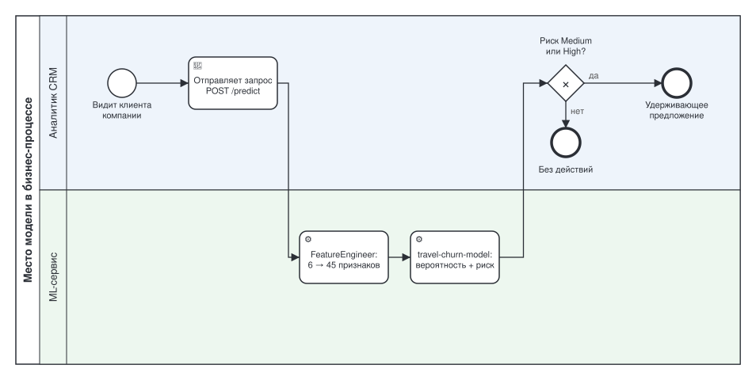

# Место модели в процессе (BPMN)

Где `travel-churn-model` стоит в бизнес-процессе удержания клиентов туристической
компании — отдельно от того, как модель разрабатывается и переобучается (это описано
в [MODEL_LIFECYCLE.md](MODEL_LIFECYCLE.md) и [Model_retrain_BPMN.md](Model_retrain_BPMN.md)).
Модель — [`travel-churn-model`](model_card.md).

- [`model_business_process.bpmn`](model_business_process.bpmn) — та же схема в
  формате BPMN 2.0: открывается в [demo.bpmn.io](https://demo.bpmn.io)
  (Open diagram) и Camunda Modeler.
- Схема и файл генерируются из одного описания:
  `poetry run python scripts/generate_bpmn.py` (тот же скрипт, что строит
  диаграммы жизненного цикла и переобучения — все три процесса описаны в одном
  файле, `scripts/generate_bpmn.py`).

## Какую задачу в процессе решает модель

Аналитик CRM и маркетинга не может вручную оценить вероятность оттока для каждого из
тысяч клиентов и расставить приоритеты, кому первым звонить с удерживающим
предложением. Модель берёт эту оценку на себя: на входе — данные о клиенте, на
выходе — вероятность оттока и уровень риска (Low / Medium / High), который
расставляет приоритеты для удерживающей кампании. Решение, писать клиенту или нет, —
всегда за человеком; модель только сортирует клиентов по риску.

## Почему для этой задачи целесообразно использовать ML

На входе всего 6 признаков клиента, но после `FeatureEngineer`
(см. [model_card.md](model_card.md#3-данные)) модель видит уже 45 признаков с
попарными взаимодействиями — например, сочетание `FrequentFlyer` и
`BookedHotelOrNot` меняет риск иначе, чем каждый признак сам по себе. Сформулировать
такую нелинейную зависимость как набор ручных правил непрактично: правил было бы
слишком много, и они бы не учитывали взаимодействия между признаками. При этом
переобучить модель на новых данных дешевле, чем пересматривать вручную написанные
правила заново, — процесс переобучения занимает минуты
(см. [Model_retrain_BPMN.md](Model_retrain_BPMN.md)).

## Какие данные поступают на вход модели

Шесть исходных признаков из CRM-системы: `Age`, `FrequentFlyer`,
`AnnualIncomeClass`, `ServicesOpted`, `AccountSyncedToSocialMedia`,
`BookedHotelOrNot` — через `POST /api/v1/predict` или `/api/v1/predict_batch`
(подробное кодирование — [model_card.md, раздел 3](model_card.md#3-данные)).
Сервис сам превращает их в 45 признаков перед подачей в модель; аналитик передаёт
только исходные шесть.

## Как результат работы модели используется дальше в процессе

Ответ API — вероятность оттока, класс (уйдёт / останется) и уровень риска —
попадает в CRM-интерфейс аналитика. Клиентов с риском Medium и High аналитик берёт в
удерживающую кампанию (скидка, персональное письмо, звонок менеджера); клиентов с
риском Low — не трогает, чтобы не тратить ресурс кампании впустую. Каждый запрос к
API также попадает в журнал мониторинга — это уже вход для процесса переобучения
([Model_retrain_BPMN.md](Model_retrain_BPMN.md)), а не для этого бизнес-процесса.
