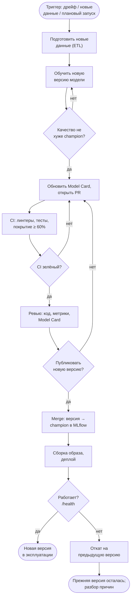
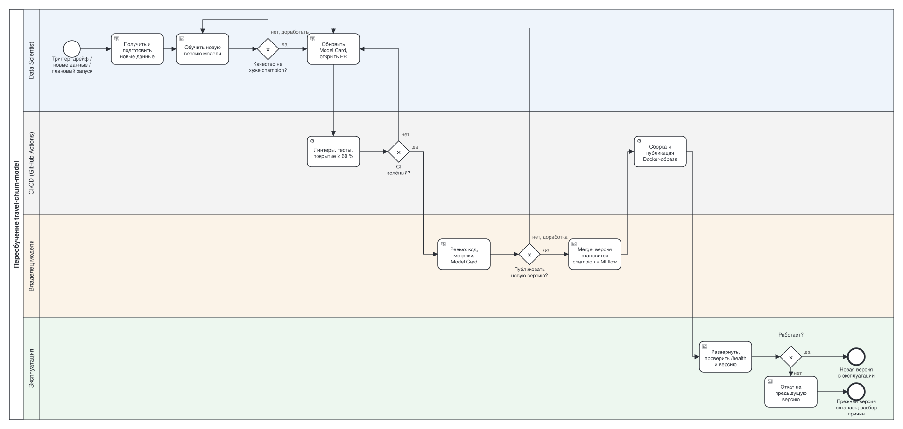

# Процесс автоматического переобучения (BPMN)

Процесс от триггера, запускающего переобучение `travel-churn-model`, до развёртывания
новой версии или отказа от неё. Это тот же конвейер, что в
[жизненном цикле модели](MODEL_LIFECYCLE.md) (там он показан на шагах 1–13), но в
отдельной схеме — в рамке «что происходит после срабатывания триггера». Ежедневная
проверка дрейфа, которая чаще всего и становится триггером, расписана в
[MODEL_LIFECYCLE.md](MODEL_LIFECYCLE.md), шаги 14–19.

Та же схема подробнее, как диаграмма BPMN 2.0 с дорожками по ролям:

- [`model_retrain.bpmn`](model_retrain.bpmn) — та же схема в формате BPMN 2.0:
  открывается в [demo.bpmn.io](https://demo.bpmn.io) (Open diagram) и Camunda Modeler.
- Схема и файл генерируются из одного описания:
  `poetry run python scripts/generate_bpmn.py` (тот же скрипт, что строит диаграмму
  жизненного цикла — обе схемы описаны как два отдельных процесса в одном файле,
  `scripts/generate_bpmn.py`).

## Участники (дорожки)

Те же роли, что в [жизненном цикле модели](MODEL_LIFECYCLE.md):

| Дорожка | Кто | Отвечает за |
|---|---|---|
| Data Scientist | разработчик модели | новые данные, обучение, сравнение с `champion`, Model Card, Pull Request |
| CI/CD | GitHub Actions (`ci-cd.yml`) | автоматические проверки, сборка и публикация образа |
| Владелец модели | ревьюер Pull Request | решение, публиковать ли новую версию |
| Эксплуатация | API на сервере | развёртывание, проверка здоровья, откат при неудаче |

## Шаги

| # | Шаг | Исполнитель | Что происходит | Результат, передаваемый дальше |
|---|---|---|---|---|
| 1 | Триггер переобучения | — | один из трёх источников: автоматический (дрейф — PSI > 0.25, KS p < 0.05 или JS > 0.2, см. [MODEL_LIFECYCLE.md](MODEL_LIFECYCLE.md#согласование-критерии-на-шлюзах)), по новым данным (накопился журнал запросов или новая выгрузка), плановый (Data Scientist решил обновить модель без видимой проблемы) | задача «переобучить модель» |
| 2 | Получить и подготовить новые данные | Data Scientist | `src/etl/`: новые сырые данные → `data/processed/processed_data.csv` тем же пайплайном, что при первом обучении | обработанный датасет для обучения |
| 3 | Обучить новую версию модели | Data Scientist | `poetry run python -m src.training.improved_training` — сравнение алгоритмов, лучшая модель по F1, прогон и версия записываются в реестр MLflow (`mlflow.db`) | новая версия `travel-churn-model` в MLflow, `models/best_model_improved.pkl` |
| 4 | **Шлюз «Качество не хуже champion?»** | Data Scientist | сравнение прогонов в MLflow (Compare): F1, ROC AUC, качество по группам клиентов (Model Card, раздел 5) | нет → вернуться к обучению (п. 3) на тех же данных с другими параметрами/алгоритмом |
| 5 | Обновить Model Card, открыть PR | Data Scientist | `docs/model_card.md` (метрики, группы, раздел «Версии»), новая ветка + Pull Request с моделью и `mlflow.db` | PR, готовый к автоматическим проверкам |
| 6 | Автоматические проверки | CI | black, flake8, mypy, pytest, покрытие ≥ 60 % (`ci-cd.yml`) | статус проверки PR |
| 7 | **Шлюз «CI зелёный?»** | CI | статус GitHub Actions | нет → исправить код/тесты и обновить PR (п. 5) |
| 8 | Ревью кода, метрик и Model Card | Владелец модели | ревью PR на GitHub: код, метрики в MLflow, обновлённая Model Card | замечания или одобрение |
| 9 | **Шлюз «Публиковать новую версию?»** — решение о публикации | Владелец модели | Approve / Request changes | нет → доработка (п. 5) |
| 10 | Регистрация новой версии | Владелец модели | Merge pull request в main: alias `champion` в реестре MLflow и файл модели, лежавшие в ветке, становятся версией, которую использует приложение | новая версия `champion` в main |
| 11 | Деплой: сборка и публикация образа | CI | push в main → сборка Docker-образа; коммит `release: …` → публикация в Docker Hub | образ с новой моделью |
| 12 | Развернуть и проверить | Эксплуатация | `docker compose up -d --build`, `GET /api/v1/health` (`model_loaded: true`), `GET /api/v1/models` (версия совпадает с ожидаемой) | новая версия в работе или сигнал о неудаче |
| 13 | **Шлюз «Работает?»** | Эксплуатация | health-check, версия совпадает с ожидаемой | да → новая версия в эксплуатации (конец процесса) |
| 13а | Откат при неудаче | Эксплуатация | нет → предыдущий образ или `git revert` merge-коммита; alias `champion` в MLflow возвращается на прежнюю версию (см. [MODEL_LIFECYCLE.md](MODEL_LIFECYCLE.md#что-автоматизировано-а-что-нет)) | прежняя версия продолжает работать; причина сбоя — на разбор Data Scientist'у (возврат к п. 2) |

## Согласование: когда новая версия попадает в эксплуатацию

Три шлюза на пути — не формальность, а последовательность независимых проверок:

1. **Качество** (п. 4) — считает Data Scientist по цифрам MLflow, без участия человека со стороны.
2. **CI** (п. 7) — автоматический, но это проверка кода и тестов, а не качества модели.
3. **Публикация** (п. 9) — единственный шаг, где решение принимает не автор модели: владелец модели смотрит код, метрики и Model Card и решает, можно ли показывать эту версию пользователям.

Только после всех трёх новая версия доходит до merge и деплоя. Критерии шлюзов «качество»
и «CI» — те же, что в [жизненном цикле модели](MODEL_LIFECYCLE.md#согласование-критерии-на-шлюзах).

## Что автоматизировано, а что нет

| Автоматически | Вручную |
|---|---|
| Запись новой версии и прогона в реестр MLflow | Решение «качество не хуже champion» (Data Scientist смотрит сравнение) |
| Проверки CI на каждый PR | Ревью и решение о публикации (владелец модели) |
| Сборка и публикация Docker-образа после merge | Merge PR, развёртывание на сервере, откат при неудаче |

Автоматический здесь только триггер «дрейф» и прогон проверок; подготовка данных, обучение
и окончательное решение каждый раз требуют Data Scientist и владельца модели — полностью
безручного переобучения в проекте нет и сознательно не предусмотрено: решение, можно ли
показывать новую версию пользователям, должен принимать человек.
